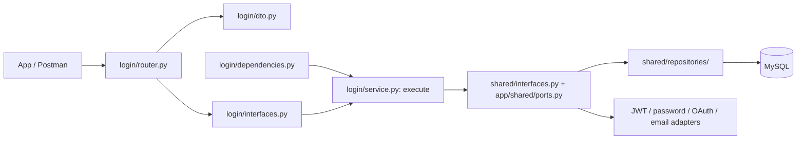
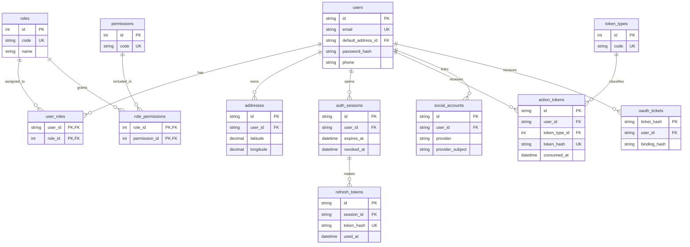

# معمارية Foodify

## حدود المرحلة الحالية

التنفيذ الحالي خاص بحساب العميل: التسجيل، تأكيد البريد، الدخول، استرجاع كلمة المرور، الجلسات، Google/Facebook، الملف الشخصي وعناوين التوصيل. التطبيق المستهدف يخدم البقالة وتوصيل الطعام؛ الطلبات والمنتجات والدفع وتعيين الموظفين مراحل لاحقة. وجود صلاحيات بأسماء الطلبات أو الموظفين في الـ seed لا يعني وجود endpoints لها الآن.

## تقسيم المشروع

التقسيم يبدأ بالكيان `users` ثم فولدر لكل عملية، وداخل كل عملية الطبقات الثلاث الخاصة بها. مثال تسجيل الدخول:

```text
app/
  users/
    login/
      dto.py           request/response تسجيل الدخول
      interfaces.py    LoginServiceInterface
      service.py       LoginService.execute
      dependencies.py  إنشاء الخدمة وحقن اعتماداتها
      router.py        استقبال طلب الدخول وإرجاع النتيجة
    register/
    verify_email/
    resend_verification/
    forgot_password/
    reset_password/
    refresh_session/
    logout/
    logout_all/
    get_profile/
    update_profile/
    addresses/
      list_addresses/
      add_address/
      update_address/
      delete_address/
      set_default_address/
    oauth/
      start/
      callback/
      complete/
    shared/
      dto/
        credentials.py البريد وقيود كلمات المرور
        primitives.py  أسماء الأشخاص والهاتف والأنواع البسيطة
        profile.py     بيانات الملف الشخصي وتحويل الاستجابة
        address.py     حقول العنوان وتحويل الاستجابة
        tokens.py      بيانات توكنات الجلسة
        messages.py    الرسائل العامة
      interfaces.py    عقود repositories والأدوات المشتركة
      repositories/
        users.py       تخزين المستخدمين
        addresses.py   تخزين العناوين
        actions.py     توكنات تأكيد البريد والاسترجاع
        sessions.py    الجلسات وتدوير refresh tokens
        social.py      OAuth states/accounts/tickets
      dependencies/
        resources.py   تركيب الأمان والبريد وUnitOfWork
        repositories.py تركيب adapters التخزين
        services.py    تركيب أدوات البريد والجلسة المشتركة
      guards.py        فحص المستخدم النشط وملكية العنوان
      email_actions.py إنشاء/التحقق من إجراءات البريد
      session_issuer.py إنشاء الجلسة وإصدار زوج التوكنات
      access_authenticator.py التحقق من access token والجلسة
      enums.py         الأنواع الثابتة الخاصة بالمصادقة
    router.py          يجمع routers العمليات فقط
  roles/               RoleType وتعريفات الأدوار والصلاحيات
  core/                الإعدادات، password/JWT adapters وmiddleware
  shared/              DTO base، error envelope، protocols المشتركة وUTC
  infrastructure/      SQLAlchemy models، MySQL، OAuth، Redis، SMTP
  dependencies.py      هوية المستخدم، الصلاحيات وحدود المحاولات العامة
  main.py              إنشاء FastAPI وتركيب router المستخدمين
  worker.py            إرسال transactional email outbox
scripts/               أوامر التشغيل المساعدة وseed
migrations/            migrations المراجعة الخاصة بـ MySQL
docs/                  المعمارية، شرح الدوال والأمان
postman/               collection وثلاثة environment templates
legacy/                نسخة Flask القديمة للرجوع إليها
```

كل فولدر عملية في الشجرة يحتوي الملفات الخمسة نفسها: `dto.py` و`interfaces.py` و`service.py` و`dependencies.py` و`router.py`، إضافة إلى `__init__.py`. العملية التي لا تستقبل body تعرف عقد مخرجاتها أو نوع مدخلها المناسب في DTO الخاص بها؛ لا تنشئ body وهميًا لطلب GET أو logout.

الأسماء في Python تستخدم `snake_case` مثل `login` و`update_profile`؛ كل اسم يصف العملية مباشرة. `app/users/router.py` يركب عمليات المصادقة تحت `/auth` والملف والعناوين تحت `/users`، ويحافظ على مسارات الـAPI الحالية. تجميع الـrouters لا يجمع منطق العمليات في service كبير.

## الطبقات الثلاث داخل العملية



| الطبقة | مكانها | مسؤوليتها |
| --- | --- | --- |
| Presentation | `operation/router.py` و`dto.py` | استقبال HTTP والتحقق من شكل البيانات وتحويلها إلى استدعاء خدمة، ثم تحديد response/status code. |
| Business / Application | `operation/service.py` وعقدها `interfaces.py` | `execute()` لحالة استخدام واحدة، تطبيق القواعد وترتيب الخطوات والتحكم في transaction عبر `UnitOfWork`. |
| Data Access | `users/shared/repositories/` وعقودها | القراءة والكتابة باستخدام SQLAlchemy، دون HTTP أو قرارات تخص مسار معين. |

`dependencies.py` المحلي هو نقطة تركيب اعتمادات العملية؛ يجمع واجهات التخزين والأدوات اللازمة لها فقط. يعتمد الـrouter على واجهة خدمة العملية، والخدمة على واجهات التخزين والأمان. لا تنفذ services استعلامات SQL مباشرة، ولا تستدعي repositories الـrouters.

نشارك repository المستخدمين بين التسجيل والدخول وتعديل الملف لأن جميعها تتعامل مع نفس الكيان؛ لا ننسخ repository لكل endpoint. كذلك `EmailActionService` و`SessionIssuer` و`AccessAuthenticator` أدوات مشتركة ذات مسؤوليات محددة، وليست خدمة كبيرة تجمع كل حالات استخدام الحساب. DTOs المشتركة تحفظ قواعد واحدة للبريد والهاتف والعنوان والتوكنات؛ DTO العملية يحدد عقدها المحلي.

عند إضافة وظيفة مثل تغيير الهاتف، أنشئ فولدر `app/users/change_phone/` بالملفات الخمسة وسجّل router الخاص به في مجمع المستخدمين. عند إضافة كيان مثل `orders` أو `catalog`، أنشئ فولدرًا مستقلًا له بنفس النمط. تعريفات الأدوار والصلاحيات في `roles/` منفصلة عن العمليات العامة للعميل.

الـrepository يضيف أو يحدّث الكيانات، وخدمة العملية تقرر `flush/commit/rollback` عبر `UnitOfWork`. يظل نفس MySQL session مستخدمًا في كل dependencies التابعة للطلب الواحد، حتى تكتب الجلسة والتوكن ورسالة outbox في transaction متسقة. الأخطاء المتوقعة ترجع `AppError` وتتحول مركزيًا إلى نفس صيغة JSON.

هذه معمارية Clean مبسطة بثلاث طبقات وعمليات مستقلة: نستخدم كيانات ORM المشتركة بدل تكرار كيانات متطابقة وmapping layers إضافية. نماذج SQLAlchemy في `infrastructure/models.py` لتعريف العلاقات؛ وجودها في مكان مشترك لا يجمع منطق حالات الاستخدام في ملف واحد. قاعدة DTOs ترفض الحقول الإضافية، لذلك لا يستطيع العميل تمرير `role` أو تعديل `is_active` عبر mass assignment.

## العلاقات وقواعد منع التكرار



| العلاقة/القيد | السبب |
| --- | --- |
| `users ↔ roles` عبر `user_roles` | يدعم أكثر من دور لنفس المستخدم؛ المفتاح المركب يمنع تكرار نفس الإسناد. |
| `roles ↔ permissions` عبر `role_permissions` | الصلاحية تعرف مرة واحدة وتشاركها الأدوار؛ لا نخزن permission arrays كنصوص في المستخدم. |
| `users → addresses` one-to-many | كل عنوان يحمل `user_id`؛ كل قراءة أو تعديل لعنوان يكون مقيدًا بصاحبه. |
| `users.default_address_id` → `addresses.id` | مصدر واحد للعنوان الافتراضي؛ `is_default` في response محسوب ولا يوجد flag مكرر في قاعدة البيانات. |
| `users → auth_sessions → refresh_tokens` | الجلسة لها عمر وإلغاء مستقل؛ كل refresh token تابع لجلسة والتدوير يسجل استخدام القديم. |
| `token_types → action_tokens` | جدول lookup لأنواع تأكيد البريد واسترجاع كلمة المرور؛ ربط بالمفتاح الأجنبي بدل تكرار تعريف النوع. |
| `users → social_accounts` | `(provider, provider_subject)` فريد، وكذلك `(user_id, provider)`؛ هوية مقدم الدخول منفصلة عن بيانات العميل. |
| البريد الإلكتروني unique | DTO يطبع صيغة البريد المستخدمة للمقارنة قبل التخزين، والـ DB تمنع إنشاء حساب مكرر أثناء requests متزامنة. |

`RoleType` هو اسم ثابت في الكود، و`roles` هو جدول lookup المرتبط بالـ bridges؛ ليس هناك جدول جديد لكل نوع موظف. الأدوار: `customer`، `courier`، `order_preparer`، `operations_manager`، `admin`. مدير العمليات هو الدور الأقل من الأدمن: يتابع العمليات ويعين التوصيلات، ولا ينشئ موظفين أو يعدل الصلاحيات. التسجيل العام يسند `customer` فقط.

رقم `users.phone` وسيلة التواصل مع صاحب الحساب؛ `addresses.phone` وسيلة التواصل مع مستلم هذا العنوان وقد يكون شخصًا آخر. هذا اختلاف في المعنى، لذلك وجود الحقلين مقصود. كذلك قد تتشارك عناوين مختلفة مدينة أو شارعًا؛ لا ننشئ lookup tables لكل نص حر، ولا نفرض uniqueness على الهاتف لأن أكثر من شخص قد يستخدم رقمًا عائليًا واحدًا.

`oauth_states` تخزن state وPKCE verifier وnonce لفترة قصيرة؛ لم يرتبط المستخدم بعد عند إنشاء state. `oauth_tickets` تربط نتيجة المصادقة بحساب وبـ challenge جاء من العميل. `email_outbox` snapshot مشفر لرسالة مطلوب إرسالها داخل نفس transaction، وليس بديلًا عن بيانات المستخدم. الـ access JWT لا يخزن في جدول؛ يتحقق منه الخادم ويطابقه مع جلسة قابلة للإلغاء.

## اتساق العناوين والتزامن

كل كتابة للعناوين تقفل صف المستخدم `SELECT ... FOR UPDATE`. إضافة أول عنوان تضيفه وتنفذ `flush` أولًا ثم تضبط `default_address_id`. حذف الافتراضي ينقل المؤشر لأقدم عنوان متبقٍ أو `NULL` وينفذ `flush` قبل الحذف. حد العناوين 20 لكل مستخدم ويتحقق تحت نفس القفل. بهذه الطريقة لا تنشئ requests متزامنة حالتين متعارضتين للعنوان الافتراضي.

الإحداثيات اختيارية كزوج، بحدود latitude من ‎-90 إلى 90 وlongitude من ‎-180 إلى 180. يتحقق DTO وقاعدة البيانات من الحدود ومن وجود القيمتين معًا. التواريخ تخزن UTC في MySQL `DATETIME`، وملف العميل والعناوين يخرجان timestamp بتمييز UTC.

## المراحل والمخطط

`APP_ENV` يختار `.env.development` أو `.env.test` أو `.env.production`. كل مرحلة لها قاعدة وRedis وcredentials خاصة بها. مرحلة `test` بيئة تشغيل للفريق المختص؛ لا تنفذ أو تضيف اختبارات تلقائيًا.

تحديث schema خطوة صريحة بـ Alembic؛ `run.py` لا ينشئ الجداول ولا ينفذ migrations. `scripts.seed` يضيف أو يحدث تعريفات الأدوار والصلاحيات وأنواع التوكنات بصورة قابلة للتكرار ولا ينشئ أدمن افتراضيًا. راجع [التشغيل](../README.md) قبل إعداد أي بيئة.

النسخة القديمة في `legacy/` وملف `foodify.db` الأصلي محفوظان للرجوع فقط. الـ FastAPI الجديد يعمل على MySQL ولا يقرأ SQLite القديم. نقل بيانات موجودة من Flask يحتاج migration بيانات منفصلة ومراجعة؛ لم ينفذ استيراد أو حذف للبيانات القديمة. ملفات الاختبارات القديمة محفوظة كما هي وتعتمد على Flask؛ ليست suite متوافقة مع التطبيق الجديد، ولم تنشأ أو تشغل اختبارات ضمن هذا التعديل.
