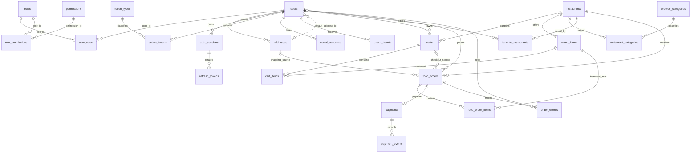

# مخطط MySQL وERD لمشروع Foodify

هذا المخطط يصف بنية قاعدة البيانات التي يبنيها كود migrations حتى `20261031_0005`. ملف [database-schema.sql](database-schema.sql) ناتج من Alembic في الوضع offline؛ لم يُنفذ على قاعدة مستضافة. استخدم migrations على قاعدة موجودة، ولا تنفذ ملف bootstrap فوق بيانات قائمة.

## ERD الكامل

## جداول الطلبات والمتاجر والدفع

| الجدول | الغرض وأهم القيود |
| --- | --- |
| `restaurants` | متجر قابل للتصنيف كـrestaurant/dessert/grocery، مع slug وشعار وبيانات التوصيل. |
| `menu_items` | أصناف المتجر وأسعارها وتوفرها. كل صنف مرتبط بمتجر واحد. |
| `browse_categories` | قاموس واحد لفئات الواجهة. |
| `restaurant_categories` | Bridge many-to-many بين المتجر والفئة؛ مفتاح مركب يمنع ربطًا مكررًا. |
| `favorite_restaurants` | Bridge many-to-many بين العميل والمتجر؛ المفتاح المركب يمنع تكرار المفضلة. |
| `carts` | سلة لكل `(user_id, restaurant_id)`؛ unique مركب، و`revision` يكشف تعديلات السلة وقت الدفع. |
| `cart_items` | صف واحد لكل `(cart_id, menu_item_id)`، والكمية محصورة من 1 إلى 99. |
| `food_orders` | طلب لمتجر واحد، عنوان JSON محفوظ كلقطة، ومفتاح checkout فريد لكل مستخدم. يحتفظ بمعرف السلة ونسختها. |
| `food_order_items` | لقطة اسم وسعر الوحدة والكمية عند الطلب؛ تمنع تغييرات المنيو من تعديل الطلب السابق. |
| `payments` | سجل واحد للطلب، وحالة المصدر المالي، مرجع Paymob وبيانات InstaPay. أسرار checkout تحفظ مشفرة، ورقم العملية verified فريد. |
| `payment_events` | سجل callback/result؛ hash الحدث مفتاح أساسي لإزالة التكرار. |
| `order_events` | مراحل الطلب مع الوقت والمنفذ والملاحظة، للتتبع وسجل التدقيق. |

## قواعد العلاقات ومنع التكرار

- المستخدم يمكنه امتلاك سلال متعددة؛ كل سلة تخص متجرًا واحدًا. الضغط على مطعم آخر لا يستبدل السلة الحالية.
- كل checkout يقرأ سلة متجر واحدة، فينشئ طلبًا واحدًا لها. تأكيد الطلب يمسح السلة نفسها فقط إذا لم تتغير `revision` منذ checkout.
- `restaurant_categories`, `favorite_restaurants`, `user_roles`, و`role_permissions` جداول bridge بعلاقات many-to-many ومفاتيح أساسية مركبة.
- اسم المنتج وسعره وعنوان التوصيل ينسخان داخل الطلب كـhistorical snapshot مقصودة؛ بقية بيانات العميل والمتجر والفئات لا تنسخ إلى كل سطر طلب.
- الطلب يظل مرتبطًا بمتجر واحد. لا يجمع Checkout أصناف متاجر مختلفة في عملية دفع واحدة.
- لا يعتمد `paid` على صفحة الرجوع أو قيمة يرسلها المتصفح. Paymob يحتاج callback موقّعة ومطابقة للمبلغ والعملة والتكامل؛ InstaPay يحتاج مراجعة موظف مخول.
- `oauth_states` مؤقتة ولا ترتبط بحساب قبل اكتمال OAuth. `email_outbox` يخزن payload مشفرًا؛ لا تحتوي هذه الجداول أسرار الدفع.

## علاقات Sprint 1 المستمرة

`users` و`roles` عبر `user_roles`، و`roles` و`permissions` عبر `role_permissions`. جلسات المستخدم في `auth_sessions` وتدوير الرموز في `refresh_tokens`. عناوين المستخدم في `addresses`. رموز التأكيد والاسترجاع في `action_tokens` مع `token_types`، وحسابات Google/Facebook في `social_accounts`.

راجع [Migration 0004](../migrations/versions/20261031_0004_marketplace_payments.py) و[Migration 0005](../migrations/versions/20261031_0005_catalog_image_urls.py)، و[شرح Sprint 2](../README_SPRINT_2.md)، و[ملف SQL](database-schema.sql).
