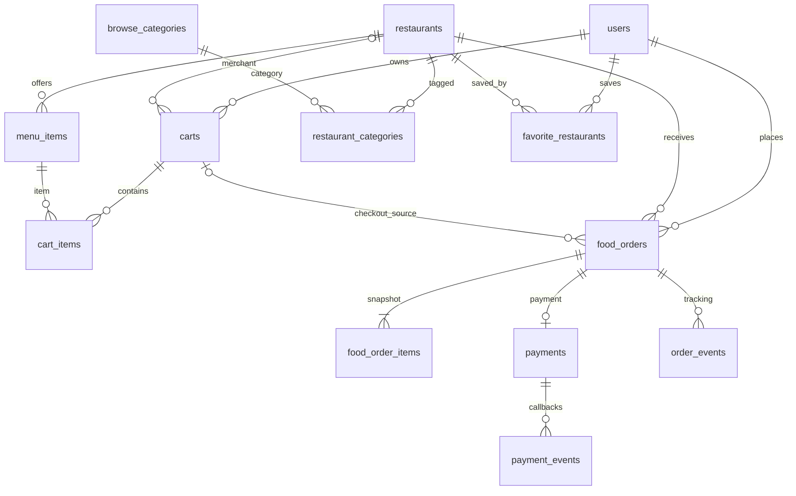

# Sprint 2 — MySQL Schema

الـERD الكامل وحقل كل مجموعة وعلاقاتها موجود في [DATABASE.md](DATABASE.md). هذا الملف يلخص تغييرات Sprint 2 عن مخطط الحسابات:

## الجداول والقيود

- `carts`: unique مركب على `(user_id, restaurant_id)` بدل سلة واحدة للمستخدم.
- `cart_items`: unique `(cart_id, menu_item_id)`، كمية من 1 إلى 99. تحديث أي عنصر يزيد revision للسلة.
- `restaurant_categories`: bridge many-to-many بين المتاجر وتصنيفات التصفح.
- `favorite_restaurants`: bridge many-to-many بين المستخدمين والمتاجر المفضلة.
- `food_orders`: متجر واحد لكل طلب؛ يمنع تكرار checkout للمفتاح نفسه داخل حساب العميل. يخزن العنوان والإجمالي والنسخة التي راجعها.
- `food_order_items`: snapshot لاسم الصنف وسعره والكمية لحظة إنشاء الطلب.
- `payments`: سجل دفع واحد لكل طلب. مفاتيح Paymob سرية، client secret مشفر في التخزين، وtransaction id فريد.
- `payment_events`: event hash فريد للتعامل idempotently مع callback المتكرر.
- `order_events`: تاريخ الحالات مع الفاعل والملاحظة، ويغذي صفحة التتبع.

تنشئ [Migration 0004](../migrations/versions/20261031_0004_marketplace_payments.py) هذه الإضافات وتحافظ على بيانات migration السابقة. ملف SQL الكامل مولد offline في [database-schema.sql](database-schema.sql). لم يطبق هذا التغيير على قاعدة مستضافة.
